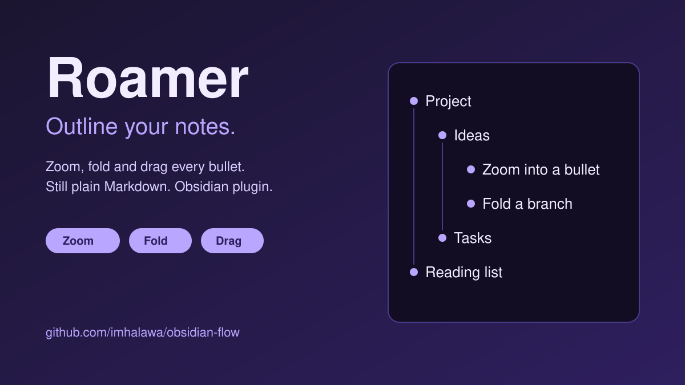

# Roamer



Outliner for Obsidian, in the spirit of RemNote, Roam Research and Logseq. Zoom into any bullet, fold branches, move items with the keyboard or by dragging. Your notes stay plain Markdown: zoom and folds are view state, so they only ever contain text you would write yourself.

Needs Obsidian 1.12.0 or newer. Built for desktop and mobile; only desktop (Linux) is tested so far.

## Features

- **Move and indent.** Indent, outdent and move an item with its children. Every change is checked against a re-parse before it is written.
- **Zoom.** Zoom into a list item or heading and see only it and what is under it. The path back up is shown in a panel above the text, and the mouse back and forward buttons step through zoom levels. Remembered per note. [Details](docs/zoom.md), [mouse history](docs/mouse-history.md).
- **Folds.** Fold an item or the whole note. Folds survive zooming. [Details](docs/folds.md).
- **Bullets and thread lines.** Select a bullet to zoom, select a thread line to fold its branch (hold Alt to fold every descendant). [Details](docs/bullets-and-thread-lines.md).
- **List editing.** Smarter Enter, Backspace, Home and select all; optional Tab and Shift-Tab move whole items. [Details](docs/list-editing.md).
- **Callout bullets.** A bullet starting with `> [!tip]` is drawn as a callout and still nests, folds and zooms. [Details](docs/callout-bullets.md).
- **Bullets stay out of the text.** Selections and the cursor stay in the text of an item, never in its bullet, and Backspace never eats a bullet. [Details](docs/list-editing.md).
- **Steady indent spacing.** Every level of a list gets the same width in any theme, so guide lines, bullets and fold arrows keep the same gaps. Turn it off to follow your theme.
- **Drag and drop.** Drag an item by its bullet, also into another open note. [Details](docs/drag-and-drop.md).

## Install

- **Beta:** add `imhalawa/obsidian-flow` in the [BRAT](https://github.com/TfTHacker/obsidian42-brat) plugin with **Add beta plugin**.
- **Manual:** download `main.js`, `manifest.json` and `styles.css` from a release into `<Vault>/.obsidian/plugins/roamer/`, then enable it in **Settings → Community plugins**.

## Commands

No default hotkeys. Bind any command in **Settings → Hotkeys**; commands appear only where they apply.

| Command                          | What it does                                    |
| -------------------------------- | ----------------------------------------------- |
| Indent item, Outdent item        | Shifts the item with its children               |
| Move item up, Move item down     | Swaps the item with a sibling                   |
| Zoom in, Zoom out                | Shows the item at the cursor, goes up one level |
| Show the whole note              | Leaves the zoom                                 |
| Zoom back, Zoom forward          | Steps through the zoom levels you visited       |
| Fold item, Unfold item           | Folds or unfolds the item at the cursor         |
| Fold all items, Unfold all items | Folds or unfolds every item with children       |

## Settings

Under **Settings → Roamer**. Every behavior can be switched off; all are on by default except **Tab and Shift-Tab move whole items**.

## Limits

- Roamer relies on a few undocumented Obsidian internals. They are listed, with how each can break, in [docs/obsidian-internals.md](docs/obsidian-internals.md).
- While you drag, the editor does not scroll. Folds are not carried into another note.
- If the zoomed item disappears (edit in another pane, sync), the whole note is shown.
- Zoom is stored in the vault's local storage on the device, so it does not sync.

Each page in [docs](docs) lists the limits of its feature.

## Privacy

No network requests, no telemetry. Reads and writes only notes in your vault.

## Development

Needs Node.js 22.12 or newer.

```bash
npm install
npm run dev
npm run check
```

| Script                  | Purpose                                                                                   |
| ----------------------- | ----------------------------------------------------------------------------------------- |
| `npm run dev`           | Watch build to `main.js`                                                                  |
| `npm run build`         | Typecheck and production bundle                                                           |
| `npm run check`         | Typecheck, lint, format check, tests with coverage                                        |
| `npm run test:mutation` | Mutation testing with Stryker                                                             |
| `npm run test:e2e`      | Tests in real Obsidian on Linux, see [docs/end-to-end-tests.md](docs/end-to-end-tests.md) |

Guidance: [CLAUDE.md](CLAUDE.md), [docs/references.md](docs/references.md), [docs/reference-plugins.md](docs/reference-plugins.md), [docs/releasing.md](docs/releasing.md).

## License

See [LICENSE](LICENSE).
