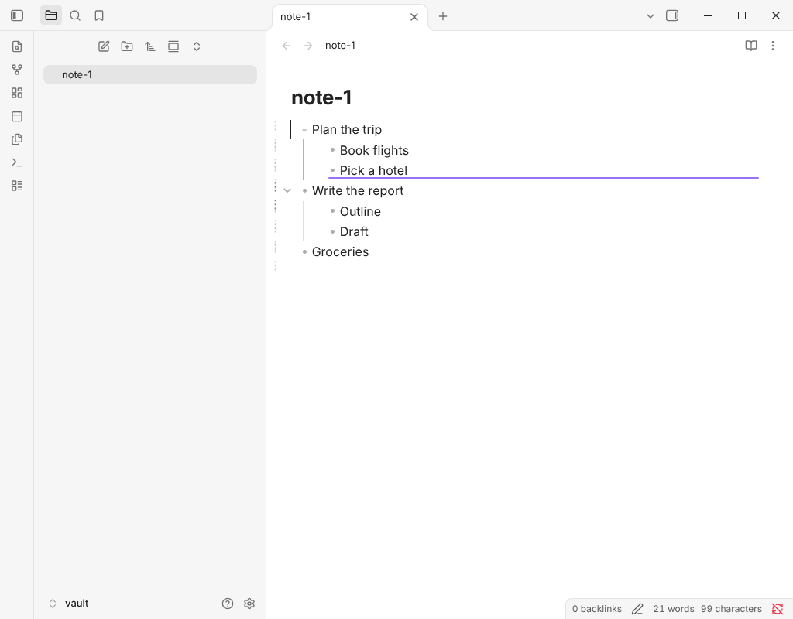
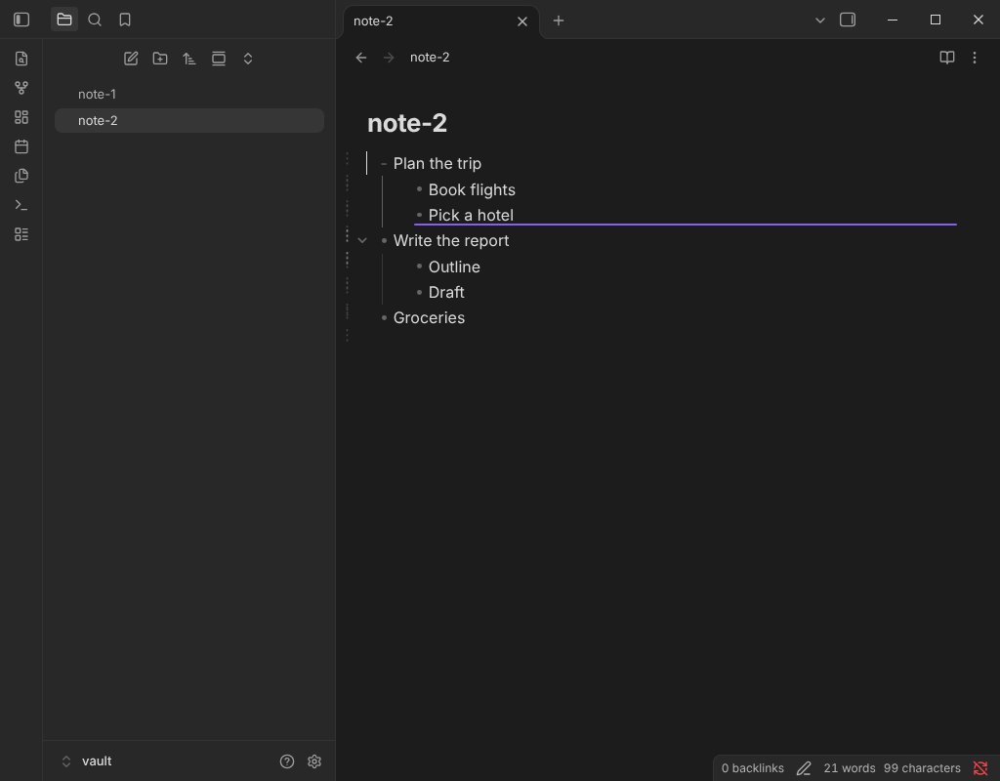

# Drag and drop

Every list item has a drag handle in the left margin of the editor. It shows when the pointer is over the item (always, dimmed, on touch screens). Drag it to move the item with its children.

## Where the item lands

A line shows where it lands while you drag. It follows the pointer:

- Over the upper half of an item: before that item.
- Over the lower half of an item that has no children, or is folded: after it, at its level.
- Over the lower half of an item that shows its children: as its first child.
- Over the text, the horizontal position picks the level. Move the pointer over the bullet of the item for its level, a level to the right to make the dragged item a child, or to the left to climb out of the parents the item ends. Keep the pointer in the margin to use the default.
- Over the item itself or one of its children: nowhere. The note stays as it is.

Press Escape before releasing the button to cancel.

The drop is one change, so one undo puts everything back. The handle follows the setting **Drag items by their handle** under **Bullets and thread lines**.

## Between notes

Drop the item on another open note, for example in a split pane. The destination note is written first and the item is removed from the source second, so a failure in between leaves a copy and never loses the item. Undo is two steps, one in each note. Two panes that show the same note count as one note.

## How it works

- The handle is drawn by the plugin as a widget at the start of each item line, with its own class names. The plugin does not look at Obsidian's own elements to find items.
- Pointer events with pointer capture on the handle, and `ownerDocument` for the key listener, so pop-out windows work.
- Targets come from `posAtCoords`, `lineBlockAt` and `coordsAtPos`. The drop indicator is a CodeMirror layer.
- The move is a pure function (`src/outline/move-subtree.ts`) that takes the item out, puts it in the new place and checks the result against a re-parse before anything is written. A property test compares it with Lezer for every item and every place of generated notes.
- Folded items stay folded after the move.

## Limits

- The editor does not scroll while you drag. Move the item in steps, or zoom into a part of the note.
- Folds of a subtree that moves to another note are not carried along.
- The handle is a 16 px wide target in the margin, because the margin is narrow. Keyboard users can use the move up and move down commands.
