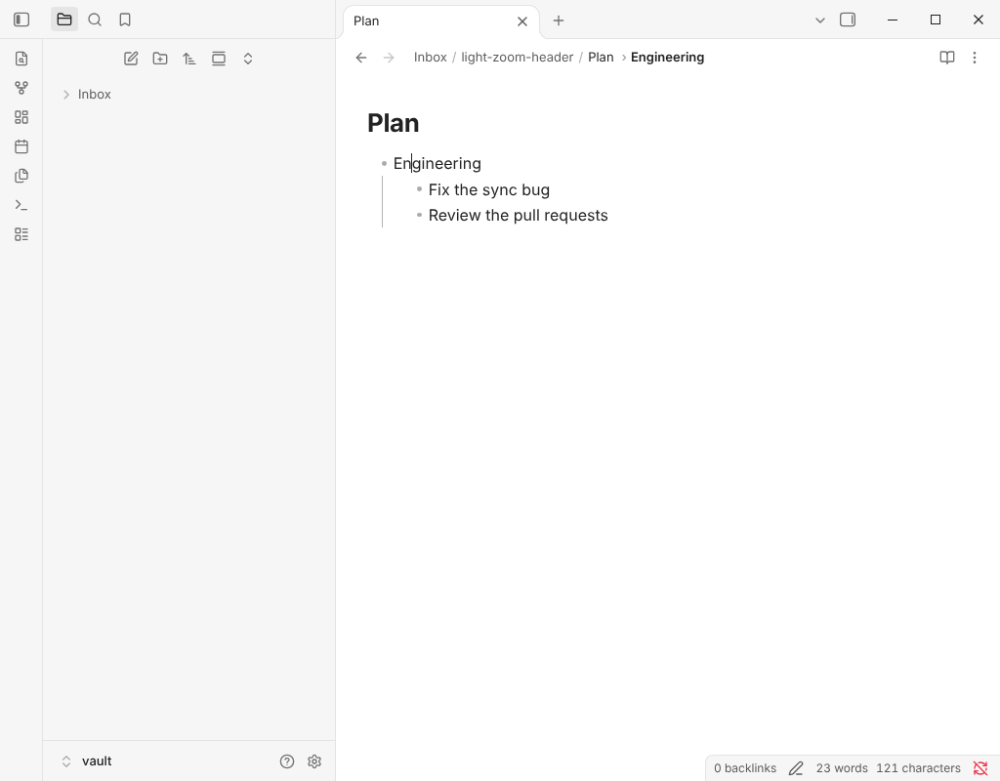
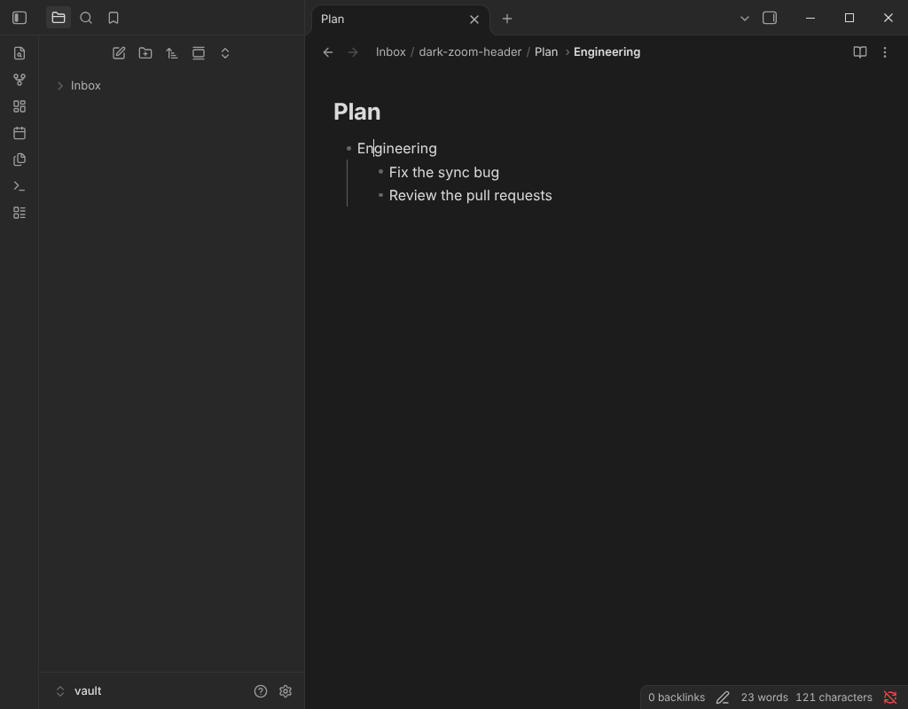

# Zoom

Zoom shows one list item, or one heading, and everything under it. Everything else in the note is hidden, not changed.

## What you can zoom into

- **A list item.** Select its bullet, or run **Zoom in** with the cursor in the item. The deepest item at the cursor is chosen.
- **A heading.** Run **Zoom in** with the cursor on a heading or in text under it that is not in a list item. The zoom covers the heading line down to the line before the next heading of the same or a higher level. Lines inside code fences and front matter are never read as headings.

**Zoom out** goes up one step: from an item to its parent item, then to the heading it sits under, then to the next heading above, then to the whole note.

## The path in the note header

The path is drawn in Obsidian's own note header, after the folder and the note name:

`Inbox / Test > Some Idea > Bullet 2 > Bullet 3`

- Headings above the zoomed target come first, outermost first, then list items down to the target. Headings are shown without their `#` marks, and an empty item as "Empty item".
- Select a level to zoom to it. The last level is the current one and is not a link. The whole note is one step away with **Show the whole note** or the mouse back button.
- When the path is wider than the header, the first level and the current level stay and the levels between them collapse into one `…` crumb. Select it (or Tab to it and press Enter or Space) for a menu of the hidden levels, top down.
- If it still does not fit, text shrinks in this order: the folder path, the first level, the current level. The full text is the tooltip and the accessible label.
- Each pane has its own path. It follows renames and is removed when the plugin is turned off.

## The zoomed item at the left edge

When the zoomed item is nested, it moves to the left edge of the note and the indent guides of the levels above it are not drawn. Guides inside the zoomed part stay. The setting **Show the zoomed item at the left edge** turns this off.

## Remembering the zoom

Zoom is remembered per note as a structural address (heading text, item text and position among equal siblings), so it survives edits above it and a restart. It is stored in the local storage of the vault on the device, never in the note.

## How it works

- The zoom is a CodeMirror state field. The text outside it is hidden with block replace decorations, which also keeps the cursor inside the zoom.
- Headings, ranges, paths and addresses are pure functions in `src/outline/` (`headings.ts`, `zoom-view.ts`, `zoom-anchor.ts`) with tables of test cases.
- The header is the only place that touches Obsidian's DOM for this feature (`src/editor/zoom-header.ts`, `src/ui/header-path.ts`). Obsidian has no API for the header, so the plugin finds the title container inside each note view and checks it exists before drawing. Which levels hide is decided by a pure function (`src/ui/fit-crumbs.ts`) from measured widths.
- The shift to the left edge is a line class with the number of levels, multiplied by the width of one indent level measured from the editor, so it follows the theme's indent width.

## Limits

- The header path needs Obsidian's note header. If the header cannot be found the plugin shows one notice and the path is not drawn.
- The left edge shift is measured from the indent the editor draws, so a theme that draws a very different indent width can show a small offset.
